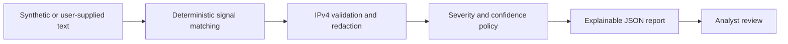

# Nyx Showcase

[](https://github.com/ShadowMITRE/Nyx-Showcase/actions/workflows/ci.yml)
[](https://www.python.org/)
[](LICENSE)

Nyx is an offline-first security triage project focused on deterministic findings, explainable decisions, and guarded automation. This repository is a sanitized, runnable portfolio edition that demonstrates the project's engineering approach without publishing the private production implementation, operational integrations, or policy corpus.

## What this edition demonstrates

- Deterministic classification of scan, SSH brute-force, and suspicious DNS language
- Validated IPv4 extraction and ranked entity summaries
- Confidence and severity escalation when independent signals corroborate one another
- Safe output handling through token, email, and local-path redaction
- Stable event hashing for correlation without retaining raw evidence
- A dependency-light CLI, synthetic examples, automated tests, and pinned CI actions

Nyx does not contact external systems, execute response actions, or use an LLM in this edition. Findings are advisory and require analyst validation.

## Quick start

Requires Python 3.11 or newer.

```bash
python -m pip install -e ".[dev]"
nyx-showcase --file examples/synthetic_events.txt --pretty
pytest
```

Analyze one event:

```bash
nyx-showcase --text "Possible SYN scan from 192.0.2.10 to 198.51.100.20" --pretty
```

The example IP addresses use documentation-only ranges and the bundled events are synthetic.

## Design



The full Nyx project adds broader parsers, local explainability contracts, policy management, memory governance, guarded action execution, approval gates, and tamper-evident receipts. Those components remain in the private repository.

## Repository guide

- `nyx_showcase/analyzer.py` — bounded, deterministic analysis pipeline
- `nyx_showcase/redaction.py` — safe output redaction helpers
- `nyx_showcase/cli.py` — JSON command-line interface
- `examples/` — synthetic, non-customer events
- `tests/` — behavioral and safety regression tests
- `docs/architecture.md` — production-oriented architecture overview
- `docs/security-model.md` — trust boundaries and limitations

## Safety and limitations

- This is a demonstration aid, not a replacement for a SIEM, EDR, IDS, or analyst judgment.
- Text matches are indicators, not proof of compromise.
- The rules are intentionally small and illustrative.
- No action is taken against hosts, identities, or network infrastructure.
- Do not submit secrets, customer records, or regulated data to public issues.

## Rights

Copyright © 2026 Amethyst Assurance Group. All rights reserved.

This code is published for portfolio evaluation only and is **not open source**. See [LICENSE](LICENSE) and [NOTICE.md](NOTICE.md) before copying, modifying, redistributing, or using it commercially.

